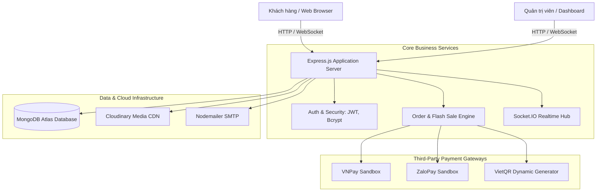

<div align="center">

# ⚡ TITISPORT — THƯƠNG MẠI ĐIỆN TỬ THỂ THAO CAO CẤP
### *Nền tảng mua sắm trang thiết bị & vận hành bán lẻ thể thao hiện đại, tích hợp Realtime và Đa cổng thanh toán số*

[](https://titisport.onrender.com)
[](https://titisport.onrender.com/admin)
[](https://titisport.onrender.com)

<p align="center">
  
  
  
  
  
  
</p>

---

</div>

## 📖 GIỚI THIỆU DỰ ÁN (PROJECT OVERVIEW)

**TITISPORT** là đồ án thực tập tốt nghiệp xây dựng hệ sinh thái thương mại điện tử chuyên ngành thể thao đa môn (Bóng đá, Bóng chuyền, Cầu lông, Giày thi đấu và Phụ kiện cao cấp). 

Dự án ra đời nhằm giải quyết bài toán trải nghiệm mua sắm trực tuyến liền mạch, tốc độ cao với giao diện phong cách thể thao hiện đại, đồng thời trang bị hệ thống quản trị vận hành (**Admin Backoffice**) khép kín, tự động hóa từ khâu săn ưu đãi, đặt hàng, xử lý kho, trừ tồn kho thời gian thực đến đối soát thanh toán điện tử.

---

## 🌟 ĐIỂM NHẤN TRẢI NGHIỆM & THIẾT KẾ ĐỘT PHÁ (KEY HIGHLIGHTS)

```
       ┌─────────────────────────────────────────────────────────────┐
       │                   TITISPORT PLATFORM                        │
       ├──────────────────────────────┬──────────────────────────────┤
       │     CLIENT STOREFRONT        │      ADMIN BACKOFFICE        │
       │  • Floating Pill Header      │  • Biểu đồ doanh thu động    │
       │  • Sport Passbook Voucher    │  • Chiến dịch Flash Sale     │
       │  • Flash Sale giờ vàng       │  • Kho sản phẩm & Đơn hàng   │
       │  • Realtime Order Stepper    │  • Ma trận phân quyền 3 tầng │
       │  • Thanh toán VNPay/ZaloPay  │  • Quản lý đánh giá & bài viết│
       └──────────────────────────────┴──────────────────────────────┘
```

### 1. 🏝️ Đảo Nổi Treo Độc Bản (Floating Pill Island Header)
- Thiết kế thanh điều hướng dạng viên nang bo tròn lơ lửng, tạo chiều sâu thị giác sang trọng.
- Xử lý chuyển động **Zero-Jitter Sticky**: Cuộn trang êm ái, hoàn toàn không bị rung giật giao diện khi ghim cố định.
- Tích hợp nhanh công cụ tìm kiếm, danh mục thả xuống mượt mà và huy hiệu giỏ hàng tự động cập nhật số lượng.

### 2. 🎟️ Ví Ưu Đãi Sport Passbook (Voucher Vault)
- Lấy cảm hứng từ vé thể thao xé cuống hiện đại, phân loại thẻ ưu đãi theo chủ đề màu sắc độc lập (`theme-red`, `theme-blue`, `theme-emerald`, `theme-purple`).
- Tích hợp tính năng sao chép mã voucher chỉ với 1 click kèm phản hồi hoạt họa trực quan và thông báo Toast nổi góc.

### 3. ⚡ Chiến Dịch Flash Deals Giờ Vàng
- Bộ đếm ngược đếm từng giây kích thích mua sắm.
- Cập nhật tỷ lệ mở bán, thanh tiến độ số lượng đã bán và trừ tồn kho tự động theo thời gian thực khi khách hoàn tất đơn hàng.

### 4. 📦 Theo Dõi Tiến Trình Đơn Hàng Thời Gian Thực (Realtime Order Stepper)
- Quy trình 5 bước trực quan: *Đặt hàng thành công ➔ Đã tiếp nhận & duyệt ➔ Đang đóng gói ➔ Đang giao hàng ➔ Hoàn tất*.
- Đèn tín hiệu **Live Pulse Dot** nhấp nháy cập nhật trạng thái đơn hàng thời gian thực qua giao thức **Socket.IO**.

### 5. 💳 Hệ Sinh Thái Thanh Toán Số Toàn Diện
- **VNPay Sandbox:** Thanh toán quét mã QR & thẻ ngân hàng nội địa/quốc tế.
- **ZaloPay Sandbox:** Thanh toán nhanh qua ví điện tử ZaloPay.
- **Chuyển khoản VietQR:** Tự động tạo mã QR chính xác thông tin số tài khoản, số tiền và mã đơn hàng, hiển thị hướng dẫn sao chép thông tin chỉn chu.

### 6. 🎨 Nhịp Điệu Thị Giác Xen Kẽ (Zebra Striping)
- Các phân khu trên trang chủ tự động đan xen nền **Xám nhạt (#f8fafc) — Trắng (#ffffff)** khoa học, tạo cảm giác phân tách khối nội dung tự nhiên, tránh mỏi mắt cho người dùng.

---

## 🎯 BẢN ĐỒ TÍNH NĂNG TOÀN DIỆN (SYSTEM FEATURE MATRIX)

| Phân hệ | Tính năng chính | Mô tả chi tiết trải nghiệm |
| :--- | :--- | :--- |
| **Khách hàng** | **Trang chủ & Khám phá** | Hero Banner động, Trust Features Bar cam kết dịch vụ, Khám phá bộ môn thể thao, Đối tác thương hiệu SVG tối giản |
| **Khách hàng** | **Bộ sưu tập & Bộ lọc** | Xem theo danh mục thể thao, lọc giá, sắp xếp mới nhất / giá tăng - giảm, tìm kiếm từ khóa thông minh |
| **Khách hàng** | **Chi tiết sản phẩm** | Thư viện Swiper Gallery trượt mượt mà, chọn biến thể kích cỡ / màu sắc, tình trạng tồn kho tức thì |
| **Khách hàng** | **Đánh giá Verified Buyer** | Hệ thống nhận xét từ người mua thực tế, chấm điểm sao, phân tích phân bổ rating và bộ lọc review |
| **Khách hàng** | **Giỏ hàng & Khuyến mãi** | Thanh tiến độ miễn phí vận chuyển (Freeship Goal), áp dụng mã giảm giá trực tiếp, tính tổng tiền tự động |
| **Khách hàng** | **Tài khoản & Cá nhân** | Đăng ký, đăng nhập bảo mật JWT, lấy lại mật khẩu bằng mã OTP gửi về Email, lịch sử mua sắm và in hóa đơn |
| **Quản trị** | **Dashboard Analytics** | Thống kê doanh thu theo kỳ, biểu đồ doanh thu so sánh trực quan, tổng đơn hàng, khách hàng mới |
| **Quản trị** | **Quản lý Flash Sale** | Thiết lập chiến dịch giờ vàng, popup chọn nhanh sản phẩm từ kho, áp dụng hàng loạt % giảm giá và hạn mức bán |
| **Quản trị** | **Quản lý Kho & Danh mục** | Cây danh mục đa cấp, CRUD sản phẩm, tải ảnh lên Cloudinary, trình soạn thảo TinyMCE, thùng rác khôi phục |
| **Quản trị** | **Quản lý Đơn hàng** | Cập nhật tiến trình giao hàng, xác nhận chuyển khoản ngân hàng, xuất và in phiếu giao hàng chuẩn |
| **Quản trị** | **Voucher & Mã giảm giá** | Tạo mã giảm giá theo số tiền cố định hoặc %, giới hạn lượt sử dụng và thời hạn hiệu lực |
| **Quản trị** | **Phân quyền & Tài khoản** | Ma trận quyền hạn chi tiết (Quản trị viên, Nhân viên kinh doanh, Biên tập viên nội dung) |

---

## 🏗️ KIẾN TRÚC HỆ THỐNG & CÔNG NGHỆ (ARCHITECTURE & TECH STACK)



### Chi tiết Stack công nghệ:
- **Backend:** Node.js v20+, Express.js v5, Mongoose v9, Socket.IO v4.
- **Frontend Template:** Pug (Jade) SSR — tốc độ render nhanh, tối ưu SEO vượt trội.
- **Frontend Styling:** Vanilla CSS với kiến trúc Design Tokens độc lập, 0% phụ thuộc Tailwind, responsive 5 breakpoint chuẩn mực.
- **Bảo mật:** JSON Web Token (JWT), `bcryptjs` hashing, `express-rate-limit`, cookie an toàn `httpOnly`, bảo vệ route theo vai trò.
- **Lưu trữ đám mây:** Cloudinary tích hợp Multer Storage.
- **Hạ tầng Online:** Render.com Cloud Web Service + UptimeRobot giám sát 24/7.

---

## 🌐 TRẢI NGHIỆM TRỰC TUYẾN (LIVE DEMO & TEST ACCOUNTS)

Hệ thống đã được đóng gói và triển khai hoạt động ổn định trên nền tảng đám mây:

- 🚀 **Trang Cửa Hàng (Client):** **[https://titisport.onrender.com](https://titisport.onrender.com)**
- 🛡️ **Trang Quản Trị (Admin):** **[https://titisport.onrender.com/admin](https://titisport.onrender.com/admin)**

*(Bạn có thể tự do đăng ký tài khoản khách hàng để trải nghiệm mua sắm, nhận mã OTP qua email thật, hoặc đăng nhập bảng điều khiển Admin để khám phá hệ thống quản trị).*

---

## ⚡ BẮT ĐẦU NHANH CHO NHÀ PHÁT TRIỂN (QUICK START)

Nếu bạn muốn chạy thử nghiệm dự án trên máy cá nhân:

```bash
# 1. Tải mã nguồn về máy
git clone https://github.com/PhanVuLinh/website_DoTheThao.git
cd website_DoTheThao

# 2. Cài đặt thư viện phụ thuộc (sử dụng cờ --legacy-peer-deps)
npm install --legacy-peer-deps

# 3. Tạo file .env và cấu hình kết nối MongoDB, Cloudinary, Email
# (Tham khảo mẫu trong tài liệu cấu hình hoặc dùng kết nối MongoDB Atlas của bạn)

# 4. Khởi động máy chủ cục bộ
npm start
# ➔ Mở trình duyệt tại địa chỉ: http://localhost:3000
```

---

## 👨‍🎓 THÔNG TIN ĐỒ ÁN & TÁC GIẢ (CREDITS)

- **Đề tài:** Xây dựng website thương mại điện tử chuyên kinh doanh đồ thể thao cao cấp.
- **Học phần:** Đồ án Thực tập tốt nghiệp.
- **Giảng viên hướng dẫn:** Thầy Nghĩa.
- **Sinh viên thực hiện:** **Phan Vũ Linh**
- **Email liên hệ:** [linhphanzzz04@gmail.com](mailto:linhphanzzz04@gmail.com)
- **GitHub:** [@PhanVuLinh](https://github.com/PhanVuLinh)

---

<div align="center">
  <p><i>Được xây dựng với niềm đam mê công nghệ và tinh thần thể thao bứt phá mọi giới hạn.</i></p>
  <p>© 2026 Phan Vũ Linh. All Rights Reserved.</p>
</div>
