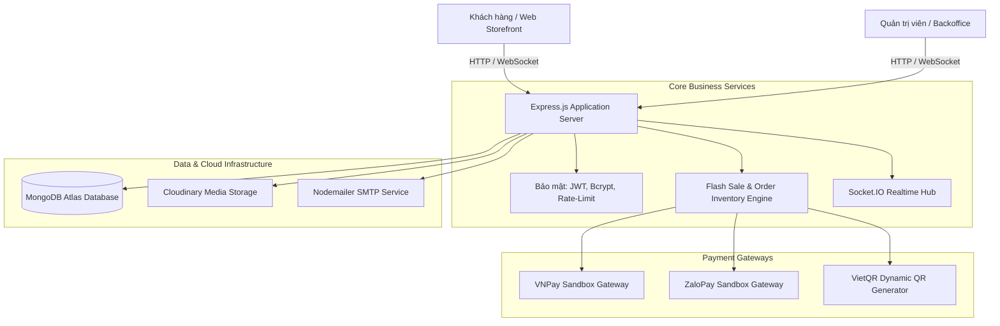

<div align="center">

# ⚡ TITISPORT — NỀN TẢNG THƯƠNG MẠI ĐIỆN TỬ THỂ THAO CAO CẤP
### *Modern E-Commerce Platform for Sports Apparel & Equipment*

[](https://titisport.onrender.com)
[](https://titisport.onrender.com/admin)
[](https://titisport.onrender.com)

<p align="center">
  
  
  
  
  
  
</p>

---

</div>

## 📖 GIỚI THIỆU SẢN PHẨM (ABOUT TITISPORT)

**TITISPORT** là sản phẩm website thương mại điện tử chuyên ngành thể thao đa môn (Bóng đá, Bóng chuyền, Cầu lông, Giày thi đấu và Phụ kiện cao cấp) được thiết kế và phát triển độc lập từ A đến Z bởi **Phan Vũ Linh**.

Sản phẩm được định hình như một nền tảng bán lẻ trực tuyến hiện đại với tốc độ xử lý nhanh, tối ưu trải nghiệm người dùng (**UI/UX**) theo phong cách thể thao năng động, đồng thời trang bị hệ thống quản trị vận hành (**Admin Backoffice**) chuyên nghiệp, hỗ trợ tự động hóa luồng bán hàng từ chiến dịch khuyến mãi đến xử lý đơn hàng và đối soát thanh toán số.

---

## 🌐 TRẢI NGHIỆM TRỰC TIẾP (LIVE DEMO)

Hệ thống đã được đóng gói và vận hành ổn định trên nền tảng Cloud:

- 🚀 **Trang Mua Sắm Khách Hàng (Client):** **[https://titisport.onrender.com](https://titisport.onrender.com)**
- 🛡️ **Hệ Thống Quản Trị Viên (Admin):** **[https://titisport.onrender.com/admin](https://titisport.onrender.com/admin)**

*(Bạn có thể trực tiếp tạo tài khoản mua hàng, đặt hàng thanh toán thử qua cổng VNPay/ZaloPay/VietQR hoặc đăng nhập trải nghiệm các phân hệ quản lý kho, đơn hàng và chiến dịch khuyến mãi).*

---

## 🌟 ĐIỂM NHẤN SÁNG TẠO & ĐỘT PHÁ CÔNG NGHỆ

```
       ┌─────────────────────────────────────────────────────────────┐
       │                   TITISPORT ECOSYSTEM                       │
       ├──────────────────────────────┬──────────────────────────────┤
       │     CLIENT STOREFRONT        │      ADMIN OPERATIONS        │
       │  • Floating Pill Header      │  • Analytics & Biểu đồ doanh thu│
       │  • Kho Voucher Passbook      │  • Chiến dịch Flash Sale     │
       │  • Flash Deals giờ vàng      │  • Quản lý Sản phẩm & Kho    │
       │  • Realtime Order Stepper    │  • Đơn hàng & In phiếu giao  │
       │  • Cổng thanh toán VNPay/Zalo│  • Phân quyền ma trận Roles  │
       └──────────────────────────────┴──────────────────────────────┘
```

### 1. 🏝️ Đảo Nổi Treo Độc Bản (Floating Pill Island Header)
- Thiết kế thanh điều hướng dạng viên nang bo tròn lơ lửng, tạo chiều sâu thị giác sang trọng và hiện đại.
- Cơ chế **Zero-Jitter Sticky**: Cuộn trang cực kỳ êm ái, khắc phục hoàn toàn hiện tượng rung giật giao diện khi cố định trên đỉnh trang.
- Tích hợp bộ tìm kiếm nhanh, menu phân cấp mượt mà và giỏ hàng cập nhật số lượng tức thì.

### 2. 🎟️ Kho Ưu Đãi Sport Passbook (Voucher Vault)
- Thiết kế dạng vé xé thể thao cá tính, phân tách chủ đề màu sắc độc lập (`theme-red`, `theme-blue`, `theme-emerald`, `theme-purple`).
- Sao chép mã 1-click kèm hoạt họa phản hồi trực quan và thông báo Toast nổi góc màn hình tinh tế.

### 3. ⚡ Chiến Dịch Flash Deals Giờ Vàng
- Tích hợp bộ đếm ngược thời gian thực kích thích nhu cầu mua sắm.
- Tự động kiểm tra hạn mức mở bán, thanh tiến độ số lượng đã bán và trừ kho trực tiếp khi đơn hàng thanh toán thành công.

### 4. 📦 Theo Dõi Tiến Trình Đơn Hàng Thời Gian Thực (Realtime Order Stepper)
- Trực quan hóa hành trình đơn hàng qua 5 chặng: *Đặt hàng ➔ Tiếp nhận ➔ Đóng gói ➔ Đang giao ➔ Giao thành công / Đã hủy*.
- Tín hiệu đèn **Live Pulse Dot** cập nhật trạng thái đơn hàng thời gian thực qua giao thức **Socket.IO**.

### 5. 💳 Hệ Sinh Thái Thanh Toán Số Đa Kênh
- **VNPay Sandbox:** Thanh toán bằng mã QR-Pay, thẻ ngân hàng nội địa và quốc tế.
- **ZaloPay Sandbox:** Thanh toán tức thời qua ví điện tử ZaloPay.
- **Chuyển khoản VietQR:** Tự động sinh mã QR với số tiền và nội dung chuyển khoản chính xác theo từng mã đơn hàng, tích hợp nút sao chép thông tin nhanh chóng.

### 6. 🎨 Nhịp Điệu Thị Giác Xen Kẽ (Zebra Striping)
- Các khối nội dung trên trang chủ luân phiên giữa nền **Xám nhạt (#f8fafc) — Trắng (#ffffff)** khoa học, tạo điểm nhấn tương phản tinh tế và bảo vệ mắt người dùng khi lướt web lâu.

---

## 🎯 BẢN ĐỒ TÍNH NĂNG TOÀN DIỆN (FEATURE MATRIX)

| Phân hệ | Nhóm chức năng | Trải nghiệm chi tiết |
| :--- | :--- | :--- |
| **Cửa Hàng (Client)** | **Trang chủ & Khám phá** | Hero Banner động, Trust Features Bar cam kết chất lượng, Khám phá bộ môn thể thao, Đối tác thương hiệu SVG tối giản |
| **Cửa Hàng (Client)** | **Danh mục & Tìm kiếm** | Cây danh mục thể thao đa cấp, lọc theo mức giá, sắp xếp theo độ mới/giá bán, tìm kiếm từ khóa thông minh |
| **Cửa Hàng (Client)** | **Chi tiết sản phẩm** | Thư viện Swiper Gallery kéo trượt mượt mà, chọn biến thể size/màu, kiểm tra tồn kho theo từng phân loại |
| **Cửa Hàng (Client)** | **Đánh giá Verified Buyer** | Hệ thống nhận xét từ người mua hàng thực tế, chấm điểm sao, phân tích phân bổ rating và bộ lọc review |
| **Cửa Hàng (Client)** | **Giỏ hàng & Khuyến mãi** | Thanh tiến độ mục tiêu Freeship Goal, áp dụng mã voucher trực tiếp, tính toán ưu đãi tự động |
| **Cửa Hàng (Client)** | **Tài khoản cá nhân** | Đăng ký/đăng nhập JWT an toàn, lấy lại mật khẩu bằng OTP gửi qua Email, quản lý hồ sơ và in hóa đơn |
| **Quản Trị (Admin)** | **Trung tâm Dashboard** | Thống kê doanh thu theo kỳ, biểu đồ doanh thu so sánh trực quan, tổng đơn hàng, khách hàng mới |
| **Quản Trị (Admin)** | **Chiến dịch Flash Sale** | Thiết lập chiến dịch giờ vàng, popup chọn nhanh sản phẩm từ kho, công cụ thiết lập % giảm giá và giới hạn số lượng mở bán |
| **Quản Trị (Admin)** | **Kho sản phẩm & Danh mục** | Quản lý danh mục đa cấp, CRUD sản phẩm, tối ưu ảnh với Cloudinary, soạn thảo bài viết TinyMCE, thùng rác khôi phục |
| **Quản Trị (Admin)** | **Xử lý đơn hàng** | Cập nhật tiến trình giao hàng, xác thực thanh toán ngân hàng, xuất và in phiếu giao hàng chuẩn |
| **Quản Trị (Admin)** | **Vouchers & Ưu đãi** | Tạo mã giảm giá theo số tiền cố định hoặc %, giới hạn lượt sử dụng và thời hạn hiệu lực |
| **Quản Trị (Admin)** | **Phân quyền ma trận** | Phân chia vai trò linh hoạt (Quản trị viên, Nhân viên kinh doanh, Biên tập viên nội dung) với bảng phân quyền chi tiết |

---

## 🏗️ KIẾN TRÚC HỆ THỐNG & CÔNG NGHỆ (ARCHITECTURE & TECH STACK)



### Công nghệ sử dụng:
- **Backend Core:** Node.js (v20+), Express.js (v5), Mongoose ODM (v9), Socket.IO (v4).
- **Template Engine:** Pug (Jade) Server-Side Rendering — tối ưu SEO và tốc độ tải trang lần đầu (First Contentful Paint).
- **Styling Architecture:** Vanilla CSS xây dựng theo hệ thống Design Tokens độc lập, không phụ thuộc Tailwind, responsive chuẩn mực trên mọi kích thước màn hình.
- **Bảo mật:** JSON Web Token (JWT), `bcryptjs`, `express-rate-limit`, cookie an toàn `httpOnly`, phân quyền đa tầng.
- **Dịch vụ Đám mây:** MongoDB Atlas, Cloudinary Media CDN, Render Cloud Service, UptimeRobot 24/7.

---

## ⚡ CÀI ĐẶT & CHẠY THỬ NGHIỆM LOCAL (GETTING STARTED)

Nếu bạn muốn chạy thử nghiệm mã nguồn trên môi trường cục bộ:

```bash
# 1. Tải mã nguồn về máy
git clone https://github.com/PhanVuLinh/website_DoTheThao.git
cd website_DoTheThao

# 2. Cài đặt các gói thư viện phụ thuộc
npm install --legacy-peer-deps

# 3. Cấu hình file .env kết nối MongoDB và các dịch vụ thứ ba
# (Tham khảo cấu hình trong file .env.example)

# 4. Khởi động ứng dụng
npm start
# ➔ Mở trình duyệt tại: http://localhost:3000
```

---

## 👨‍💻 TÁC GIẢ & THÔNG TIN LIÊN HỆ (CREATOR)

Sản phẩm được thiết kế và phát triển độc lập bởi:

<div align="center">

### **PHAN VŨ LINH**
*Full-stack Web Developer & Product Creator*

[](https://github.com/PhanVuLinh)
[](mailto:linhphanzzz04@gmail.com)
[](https://titisport.onrender.com)

</div>

---

<div align="center">
  <p><i>TITISPORT — Bứt phá mọi giới hạn trong trải nghiệm thương mại điện tử thể thao.</i></p>
  <p>© 2026 Phan Vũ Linh. All Rights Reserved.</p>
</div>
